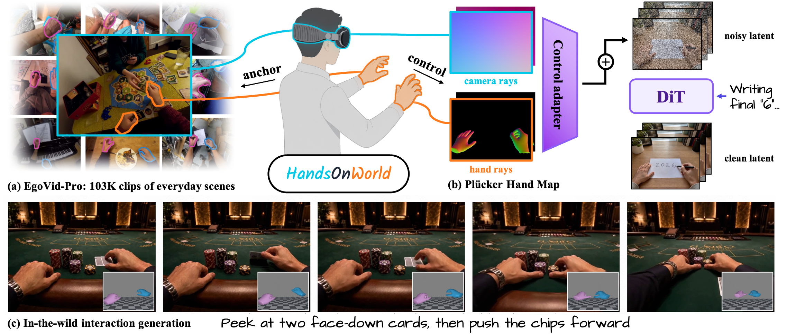

# HandsOnWorld: Unconstrained Egocentric Video Generation with Camera-Disentangled Hand Control

[Yushuo Chen](https://shad0wta9.github.io/)<sup>1,2</sup>, [Xiaoyu Shi](https://xiaoyushi97.github.io)<sup>2</sup>, [Xiaoshi Wu](https://github.com/tgxs002)<sup>3</sup>, [Xintao Wang](https://xinntao.github.io)<sup>2</sup>, [Pengfei Wan](https://magicwpf.github.io)<sup>2</sup>, [Yebin Liu](https://scholar.google.com/citations?user=ogXIdlYAAAAJ&hl=zh-CN)<sup>1</sup>

<sup>1</sup>Tsinghua University <sup>2</sup>Kling Team, Kuaishou Technology <sup>3</sup>Chinese University of Hong Kong

[Project Page](https://shad0wta9.github.io/handsonworld-page/) · [Paper](https://arxiv.org/pdf/2607.02075) · [arXiv](https://arxiv.org/abs/2607.02075) · [Code](https://github.com/KlingAIResearch/HandsOnWorld) · [Models](https://huggingface.co/KlingTeam/HandsOnWorld)



# Installation

## 1. Environment Setup

```bash
conda create -n handsonworld python=3.10 -y
conda activate handsonworld
conda install -c conda-forge ffmpeg -y

python -m pip install --upgrade pip setuptools wheel
python -m pip install torch==2.6.0 torchvision==0.21.0 \
  --index-url https://download.pytorch.org/whl/cu124
python -m pip install ninja cmake
python -m pip install -c requirements.txt \
  -e '.[train,distill,fitting]' \
  smplx==0.1.28 human-body-prior==0.8.5.0 configer==1.3.1 \
  'huggingface_hub>=0.34,<1.0'
```

Install the two geometry dependencies separately:

```bash
# Differentiable rendering of hand control maps
python -m pip install --no-build-isolation \
  'git+https://github.com/NVlabs/nvdiffrast.git@v0.4.0'

# Rotation conversions used by our local VPoser snapshot
python -m pip install --no-build-isolation \
  'git+https://github.com/facebookresearch/pytorch3d.git@75ebeeaea0908c5527e7b1e305fbc7681382db47'

# Install the bundled, a modified DiffSynth backend
python scripts/setup_backend.py --verify-only
python scripts/setup_backend.py
```

## 2. Download Required Files

### a. Wan Base Models

We provide training using the following models:

| Backbone | Official weights | Local directory |
| --- | --- | --- |
| Wan2.2 I2V A14B | [Wan-AI/Wan2.2-I2V-A14B](https://huggingface.co/Wan-AI/Wan2.2-I2V-A14B) | `models/Wan2.2-I2V-A14B/` |
| Wan2.1 I2V 14B 480P | [Wan-AI/Wan2.1-I2V-14B-480P](https://huggingface.co/Wan-AI/Wan2.1-I2V-14B-480P) | `models/Wan2.1-I2V-14B-480P/` |
| Wan2.2 TI2V 5B | [Wan-AI/Wan2.2-TI2V-5B](https://huggingface.co/Wan-AI/Wan2.2-TI2V-5B) | `models/Wan2.2-TI2V-5B/` |

You can download with the
[Hugging Face CLI](https://huggingface.co/docs/huggingface_hub/guides/cli) (Wan2.2-I2V-A14B as example), and select the matching JSON configuration in `configs/` and update
its paths if you use a different directory.

```bash
WAN_REPO=Wan-AI/Wan2.2-I2V-A14B # modify it for other models
WAN_DIR=models/${WAN_REPO#*/}

hf download "$WAN_REPO" --local-dir "$WAN_DIR"
hf download google/umt5-xxl \
  --include 'spiece.model' 'tokenizer*.json' 'special_tokens_map.json' \
  --local-dir "$WAN_DIR/google/umt5-xxl"
```

Then prepare the model with zero-initialized control adapter:

```bash
python scripts/prepare_resources.py --model wan22_i2v14b
python scripts/prepare_resources.py --model wan21_i2v14b
python scripts/prepare_resources.py --model wan22_ti2v5b
```

By default, the processed model are stored as:

```text
models/initialized/
    wan22_i2v14b/{high,low}.safetensors
    wan21_i2v14b/single.safetensors
    wan22_ti2v5b/single.safetensors
```

### b. HandsOnWorld Checkpoints

All released checkpoints are in [KlingTeam/HandsOnWorld](https://huggingface.co/KlingTeam/HandsOnWorld).
Download the models you need into `checkpoints/`; the inference configurations
already use this directory layout.

| Model | Weights | Config |
| --- | --- | --- |
| SFT · Wan2.2 I2V A14B | [Download](https://huggingface.co/KlingTeam/HandsOnWorld/tree/main/sft/wan22_i2v14b/normal_plucker/) | [JSON](configs/wan22_i2v14b_normal_plucker.json) |
| SFT · Wan2.2 I2V A14B (subset training) | [Download](https://huggingface.co/KlingTeam/HandsOnWorld/tree/main/sft/wan22_i2v14b/normal_plucker_10k/) | [JSON](configs/wan22_i2v14b_normal_plucker.json) |
| SFT · Wan2.1 I2V 14B | [Download](https://huggingface.co/KlingTeam/HandsOnWorld/tree/main/sft/wan21_i2v14b/normal_plucker/) | [JSON](configs/wan21_i2v14b_normal_plucker.json) |
| SFT · Wan2.2 TI2V 5B | [Download](https://huggingface.co/KlingTeam/HandsOnWorld/tree/main/sft/wan22_ti2v5b/normal_plucker/) | [JSON](configs/wan22_ti2v5b_normal_plucker.json) |
| Self-Forcing · Wan2.1 I2V 14B (4 steps) | [Download](https://huggingface.co/KlingTeam/HandsOnWorld/tree/main/distillation/wan21_i2v14b/normal_plucker/) | [JSON](configs/distillation/wan21_normal.json) |

```bash
# Download only the SFT backbone you want; change the included directory as needed.
hf download KlingTeam/HandsOnWorld \
  --include 'sft/wan22_i2v14b/normal_plucker/*' --local-dir checkpoints

# Download the Wan2.1 14B distilled student and its frozen control adapter.
hf download KlingTeam/HandsOnWorld \
  --include 'distillation/wan21_i2v14b/normal_plucker/*' --local-dir checkpoints
```

### c. SMPL and VPoser (for Hand Filtering)

Download the neutral **SMPL** model from the [SMPL website](https://smpl.is.tue.mpg.de/)
and **VPoser v1.0** from the [SMPL-X downloads page](https://smpl-x.is.tue.mpg.de/download.php).

Organize the files as follows, preserving the VPoser model code and settings
alongside its checkpoint:

```text
models/
    body_models/
        smpl/
            SMPL_NEUTRAL.pkl
    vposer_v1_0/
        vposer_smpl.py
        TR00_004_00_WO_accad.ini
        snapshots/
            TR00_E096.pt
```

# Data Preparation

The default resolution for training is **640×480**. We recommend to prepare **4:3 video clips** and the corresponding annotations. The camera intrinsics will be automatically scaled to match the training resolution.

Finally, you should prepare a `train.csv` and set this path to `data.metadata` in your training configuration.
CSV entries may use absolute paths or paths relative to the CSV directory.
An optional `data.base_path` overrides that directory for training; no separate
root is needed for CSVs produced by the preparation scripts.

## 1. ARCTIC

Download and extract the data following the
[official ARCTIC instructions](https://github.com/zc-alexfan/arctic/blob/master/docs/data/README.md).
The preparation script uses the ego-view images, raw annotations, split files,
metadata, and MANO models:

```text
unpack/
    arctic_data/data/
        cropped_images/<subject>/<sequence>/0/*.jpg
        raw_seqs/
        splits_json/
        meta/
    body_models/mano/
        MANO_LEFT.pkl
        MANO_RIGHT.pkl
```

```bash
python scripts/prepare_arctic.py \
  --base-dir /path/to/arctic/unpack \
  --output-dir data/arctic \
  --mano-dir /path/to/mano # when MANO is stored separately
```

The default uses the official `p2` training split, skips the first two available
frames, and samples every second frame. ARCTIC ego images are 840×600 and are cropped into 800x600 to match the 4:3 training configuration. Captions are generated from the annotated object and
action names.

## 2. Custom dataset with protagonist filtering

Prepare a CSV with two columns, `video` and `prompt`. Relative video paths are
resolved from the CSV's directory. Supply the captions you want to train with:

```csv
video,prompt
clips/example.mp4,"A person plays a board game at a wooden table."
```

The built-in `hawor` adapter calls an external
[HaWoR](https://github.com/ThunderVVV/HaWoR) installation. Clone HaWoR and follow
its installation and model-download instructions, then pass its directory below.

```bash
python scripts/prepare_videos.py \
  --input-csv /path/to/clips.csv \
  --hawor-root /path/to/HaWoR \
  --output-dir data/custom
```

This runs hand estimation, protagonist hand filtering, and camera reconstruction,
then exports aligned videos and controls while preserving your captions.

By default, the filter checks the first frame of each candidate chunk. To check
all frames and keep a chunk only when **more than 90%** pass, add:

```bash
--sampling all_frames --min-pass-ratio 0.9
```

The threshold is configurable, and body fitting shares shape parameters within
each chunk. Results are written to `train.csv`; per-video outcomes are recorded
in `processing_report.csv`.

To use another hand estimator, implement the small `HandEstimator` interface
shown in [custom_estimator.py](examples/data_preparation/custom_estimator.py),
then select that class with the same preparation command:

```bash
python scripts/prepare_videos.py \
  --input-csv /path/to/clips.csv \
  --output-dir data/custom \
  --estimator your_package.estimator:YourEstimator \
  --estimator-config /path/to/estimator.json
```

The custom estimator supplies candidate hand tracks and reconstructs the tracks
selected by our protagonist filter.

Here we provide an EgoVid example:

The example includes precomputed annotations in
[`examples/egovid/train.csv`](examples/egovid/train.csv), which is the default
training dataset in the SFT and distillation configurations. It contains one
clip for trying the pipeline; set `data.metadata` to your own prepared CSV for
full training. To regenerate its annotations:

```bash
python scripts/prepare_videos.py \
  --input-csv examples/egovid/input.csv \
  --hawor-root /path/to/HaWoR \
  --output-dir data/example
```

# Training

## Supervised Fine-Tuning

Select the backbone through `CONFIG`; the launch interface is shared:

| Backbone | Example configuration |
| --- | --- |
| Wan2.2 I2V A14B | [wan22_i2v14b_normal_plucker.json](configs/wan22_i2v14b_normal_plucker.json) |
| Wan2.1 I2V 14B 480P | [wan21_i2v14b_normal_plucker.json](configs/wan21_i2v14b_normal_plucker.json) |
| Wan2.2 TI2V 5B | [wan22_ti2v5b_normal_plucker.json](configs/wan22_ti2v5b_normal_plucker.json) |

Set dataset paths, output paths, and training options in the selected config.
For example, on two machines with eight GPUs each, run once per machine:

```bash
CONFIG=configs/wan22_i2v14b_normal_plucker.json \
GLOBAL_SIZE=2 GLOBAL_ID=0 GPUS_PER_MACHINE=8 \
MASTER_ADDR=10.0.0.1 MASTER_FILE=/shared/handsonworld/master.json \
  bash scripts/train_cluster.sh
```

Set `GLOBAL_ID` to `0` or `1` on the respective machine, use the first machine's
reachable IP, and place `MASTER_FILE` on shared storage. For one machine, use
`GLOBAL_SIZE=1 GLOBAL_ID=0`. Adjust GPU counts and network settings for your
cluster.

## Self-Forcing Distillation

Supported backbones are Wan2.1 I2V 14B and Wan2.2 TI2V 5B. 
Run the following stages in order on every participating node:

```bash
export CONFIG=configs/distillation/wan22_ti2v5b_normal.json
# export CONFIG=configs/distillation/wan21_normal.json # if using Wan2.1 I2V 14B
export GPUS_PER_MACHINE=8

bash scripts/distill.sh prepare
bash scripts/distill.sh causal_sft
bash scripts/distill.sh ode
bash scripts/distill.sh kd
bash scripts/distill.sh dmd
```

# Inference

The released-model configurations use `examples/egovid/train.csv` for a quick
example. For your own evaluation, prepare a CSV in the same format and set
`inference.metadata` and `inference.output_dir` in the configuration.

Inference using the checkpoint from SFT:

```bash
CONFIG=configs/wan22_i2v14b_normal_plucker.json \
  bash scripts/infer_sft.sh
```

Inference using the checkpoint from self-forcing distillation:

```bash
CONFIG=configs/distillation/wan21_normal.json \
  bash scripts/distill.sh infer
```

To use your own distilled checkpoint, set `inference.checkpoint` to its completed
checkpoint directory.

# Acknowledgement

Part of our code is borrowed from the following repos, great thanks to them!

* [DiffSynth-Studio](https://github.com/modelscope/DiffSynth-Studio)
* [nvdiffrast](https://github.com/NVlabs/nvdiffrast)
* [HaWoR](https://github.com/ThunderVVV/HaWoR)
* [Self Forcing](https://github.com/guandeh17/Self-Forcing)
* [FastGen](https://github.com/NVlabs/FastGen)

# Citation

If you find this work useful for your research, please consider citing:

```bibtex
@misc{chen2026handsonworld,
    title={HandsOnWorld: Unconstrained Egocentric Video Generation with Camera-Disentangled Hand Control},
    author={Yushuo Chen and Xiaoyu Shi and Xiaoshi Wu and Xintao Wang and Pengfei Wan and Yebin Liu},
    year={2026},
    eprint={2607.02075},
    archivePrefix={arXiv},
    primaryClass={cs.CV},
    url={https://arxiv.org/abs/2607.02075}
}
```
